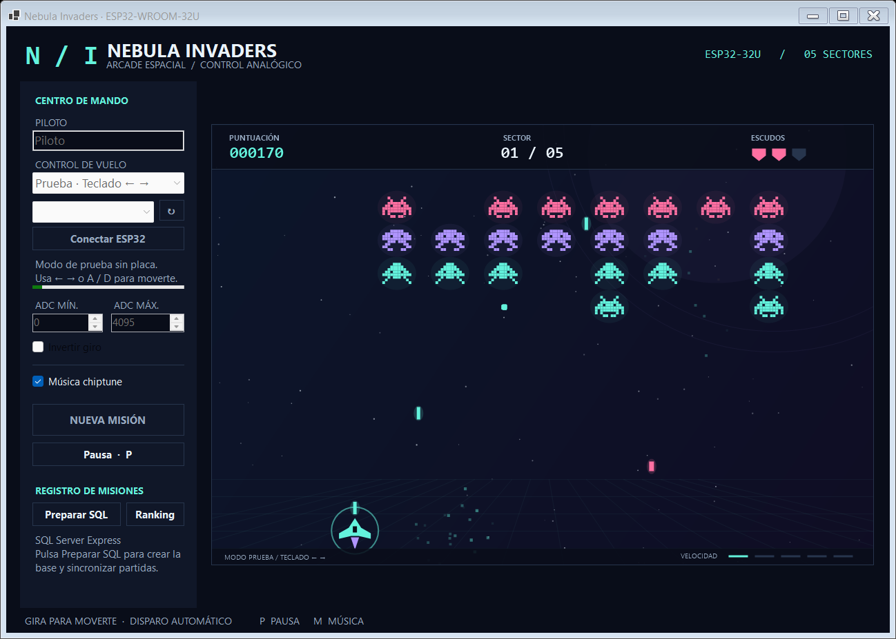

# Nebula Invaders

Un juego de invasores espaciales en **C# / .NET 10 / Windows Forms**, con cinco niveles, gráficos animados, música chiptune y control analógico desde un **ESP32-WROOM-32U con potenciómetro**. Las partidas se registran en **SQL Server Express** y pueden consultarse en el ranking del juego.

La nave dispara automáticamente: gira el potenciómetro para esquivar y apuntar. No se necesitan botones físicos para jugar. El inicio de misión y los menús se manejan desde el PC.



**Empieza por [INICIO_RAPIDO.md](docs/INICIO_RAPIDO.md).** El cableado y la carga del ESP32 están en [HARDWARE.md](docs/HARDWARE.md); la preparación y las consultas SQL, en [database/README.md](database/README.md).

## Ejecutar el juego

La entrega actual es **`NebulaInvaders-ESP32-32U-Portatil.zip`**, con el juego y .NET incluidos, y **`NebulaInvaders-ESP32-32U-Codigo.zip`**, con el proyecto editable y comentarios en español. Extrae todo el ZIP portátil y abre **`portatil/NebulaInvaders.exe`**, o `jugar.cmd`. **No necesitas instalar .NET, Visual Studio ni el juego.** Conserva la carpeta completa: las DLL incluyen el runtime que necesita el EXE. Esta versión sustituye a la anterior que pedía instalar .NET.

| Lo que quieres hacer | Necesitas |
|---|---|
| Abrir el juego portátil | Windows x64. **.NET ya viene incluido**; no hace falta instalar runtime ni SDK. |
| Compilar, modificar o ejecutar las comprobaciones | Windows y **.NET SDK 10**; Visual Studio con soporte para .NET 10 es opcional. |
| Guardar y consultar resultados en SQL | Motor **SQL Server Express** en ejecución y permisos sobre la base. |
| Jugar con el mando físico | ESP32-WROOM-32U, potenciómetro B10K, cable USB de datos y el firmware incluido. |

Solo para **modificar o compilar** el código, descarga el SDK desde la [página oficial de .NET 10](https://dotnet.microsoft.com/en-us/download/dotnet/10.0). El juego portátil usa una [publicación autocontenida](https://learn.microsoft.com/en-us/dotnet/core/deploying/), con el runtime en su propia carpeta. La interfaz utiliza Windows Forms y requiere Windows. SQL Server es un servicio aparte: puedes jugar sin él y conservar los resultados pendientes, pero guardar en SQL y consultar Ranking requiere una instancia activa local o remota.

En la distribución portátil abre **`portatil/NebulaInvaders.exe`**. Si utilizas solo el código fuente, abre una terminal en la carpeta que contiene `NebulaInvaders.sln` y ejecuta:

```powershell
dotnet run --project src/NebulaInvaders.Desktop -c Release
```

También puedes usar `jugar.cmd` desde la carpeta del proyecto. La primera compilación necesita acceso a NuGet para restaurar las dependencias. Como alternativa, abre `NebulaInvaders.sln` en Visual Studio con la carga de trabajo **Desarrollo de escritorio de .NET**, establece `NebulaInvaders.Desktop` como proyecto de inicio y pulsa F5. [Documentación de dotnet run](https://learn.microsoft.com/en-us/dotnet/core/tools/dotnet-run).

Para generar de nuevo la carpeta portátil desde el código fuente, ejecuta `publicar.ps1` en PowerShell, o `dotnet publish src/NebulaInvaders.Desktop -c Release -r win-x64 --self-contained true -p:PublishTrimmed=false -o portatil`. En Visual Studio también puedes usar el perfil `Portatil`. El resultado incluye .NET; el equipo del jugador no necesita instalarlo. El tamaño es mayor porque incluye esas bibliotecas.

## Primera misión y controles

El juego abre en **Prueba · Teclado ← →** para poder comprobarlo sin placa. Escribe tu nombre en **PILOTO** y pulsa **INICIAR MISIÓN**. Mueve la nave con **← / →** o **A / D**. Tras finalizar, **NUEVA MISIÓN** vuelve al nivel 1.

Para usar el mando, selecciona **ESP32-32U · Potenciómetro** en **CONTROL DE VUELO**, selecciona su COM y pulsa **Conectar ESP32**. Usa **↻** si la placa se conectó después de abrir el juego. Espera el estado **Señal activa** antes de iniciar.

| Acción | Control |
|---|---|
| Mover a izquierda/derecha | Girar el potenciómetro; en modo de prueba, ← / → o A / D. |
| Disparar | Automático, cuatro disparos por segundo. |
| Pausar/reanudar | **P** durante la misión o botón **Pausa / REANUDAR**. |
| Activar/desactivar música | **M** durante la misión o casilla **Música chiptune**. |
| Ver puntuaciones de SQL | Botón **Ranking**; pausa una misión activa. |

Tienes **3 vidas**. Tras un impacto recibes **1.6 segundos de protección**. Pierdes si te quedas sin vidas o la formación alcanza la altura de tu nave. La misión se pausa al cambiar a otra ventana y, en modo ESP32, cuando deja de recibir datos válidos. Reconecta el mando y pulsa **REANUDAR**; recuperar el USB no reanuda automáticamente.

Hay estrellas animadas, sprites con movimiento, explosiones de partículas, escudo y transiciones de nivel. La música se sintetiza en memoria: no necesitas descargar archivos de audio.

## Cinco niveles con velocidad creciente

Las velocidades se expresan en unidades del escenario lógico de 960 × 640 por segundo. Son valores base: la formación acelera adicionalmente cuando quedan menos invasores.

| Nivel | Nombre | Velocidad de formación | Intervalo de disparo enemigo | Velocidad de proyectil enemigo |
|---|---|---:|---:|---:|
| 1 | Primer contacto | 48 | 1.30 s | 190 |
| 2 | Órbita hostil | 68 | 1.08 s | 225 |
| 3 | Tormenta de plasma | 91 | 0.88 s | 265 |
| 4 | Asedio estelar | 120 | 0.70 s | 310 |
| 5 | Última frontera | 154 | 0.54 s | 360 |

Cada nivel comienza con 32 enemigos. Los impactos valen entre 10 y 40 puntos según la fila y completar un nivel añade `250 × número de nivel`. Superar el quinto nivel completa la misión. Para ajustar la dificultad, modifica `LevelCatalog` en [Models.cs](src/NebulaInvaders.Core/Models.cs) y recompila.

## Conectar y calibrar el ESP32-WROOM-32U

Con la placa apagada, conecta los dos extremos de un potenciómetro lineal de 10 kΩ a **3V3** y **GND**, y el cursor central a **GPIO34**. **Nunca uses 5 V en el potenciómetro ni en GPIO34.** Comprueba que GPIO34 esté libre y accesible en tu modelo concreto de placa. [Diagrama y carga paso a paso](docs/HARDWARE.md).

Carga `firmware/Esp32Wroom32UPotController/Esp32Wroom32UPotController.ino` mediante Arduino IDE, seleccionando **ESP32 Dev Module**, Flash **4 MB**, PSRAM **Disabled** y velocidad de subida **115200**. Esta placa usa el puente **CP2102** por micro USB; no necesita configurar USB CDC. Si no aparece COM, revisa el cable de datos y el controlador CP210x. Cierra el Monitor Serie antes de abrir el COM desde el juego. El firmware anterior para S3 queda sustituido por este sketch.

El mando envía `POT:<0..4095>` con final de línea a 115200 baudios y una frecuencia aproximada de 50 Hz. El firmware promedia y suaviza las lecturas para reducir vibraciones.

Antes de empezar, gira a cada extremo y observa el valor ADC que muestra el juego. Ajusta **ADC MÍN.** y **ADC MÁX.** a los extremos medidos: ambos deben estar entre 0 y 4095, con una separación mínima de **100**. Marca **Invertir giro** si el sentido está al revés. También puedes calibrar durante una pausa. El ADC puede saturarse antes del último tramo de giro; la guía explica cómo ajustar el recorrido útil.

## Preparar SQL Server Express

La conexión predeterminada es la instancia local **`.\SQLEXPRESS`**, base **`NebulaInvaders`**, con autenticación de Windows. SQL Server Management Studio (SSMS) es una herramienta de administración: también debes tener instalado y en ejecución el **motor SQL Server Express**.

1. Abre el juego y pulsa **Preparar SQL**. Crea la base y la tabla `dbo.Games` si no existen y sincroniza las partidas pendientes. Requiere permisos para crear la base y el esquema.
2. Como alternativa, ejecuta [01-create-database.sql](database/01-create-database.sql) completo desde SSMS en tu instancia Express.
3. Comprueba el estado de conexión, juega y abre **Ranking**. [02-example-queries.sql](database/02-example-queries.sql) permite consultar los registros desde SSMS.

Si tu instancia tiene otro nombre, cambia `SqlConnectionString` en **`appsettings.json` junto al ejecutable** y reinicia. Cuando compiles desde el código fuente, edita [src/NebulaInvaders.Desktop/appsettings.json](src/NebulaInvaders.Desktop/appsettings.json), que se copia a la salida de compilación:

```json
{
  "SqlConnectionString": "Server=.\\SQLEXPRESS;Database=NebulaInvaders;Integrated Security=True;Encrypt=True;TrustServerCertificate=True;Connect Timeout=5",
  "DefaultPlayerName": "Piloto",
  "PotMinimum": 0,
  "PotMaximum": 4095,
  "InvertPotentiometer": false,
  "MusicEnabled": true
}
```

En JSON, la barra del nombre de instancia se escribe doble: `\\`. Conserva **`Database=NebulaInvaders`**. También puedes definir **`NEBULA_SQL_CONNECTION`**, que tiene prioridad sobre la conexión del archivo; por ejemplo, en PowerShell antes de lanzar el juego:

```powershell
$env:NEBULA_SQL_CONNECTION = 'Server=.\SQLEXPRESS;Database=NebulaInvaders;Integrated Security=True;Encrypt=True;TrustServerCertificate=True;Connect Timeout=5'
& .\portatil\NebulaInvaders.exe
```

Los valores del JSON se leen al iniciar. **Cambiar piloto, calibración, inversión o música desde la interfaz solo afecta a esa ejecución**; para conservar tus valores iniciales entre sesiones, modifica el archivo manualmente con el juego cerrado. El nombre del piloto usado en cada partida sí se guarda con su resultado.

## Qué se guarda y cuándo

Al ganar o perder se registra el nombre, puntuación, nivel alcanzado, victoria, duración activa, tipo de control y fechas UTC. El ranking muestra las diez mejores partidas de SQL. La duración excluye pausas e introducciones.

Cada resultado se escribe primero en **`%LOCALAPPDATA%\NebulaInvaders\pending-games.json`** y después se intenta enviar a SQL. Si SQL no responde, permanece pendiente y se reintenta al terminar otra partida o al pulsar **Preparar SQL**. La aplicación avisa si encontró pendientes al abrir; ese aviso no los sincroniza por sí solo. Los identificadores únicos evitan duplicar una partida al reintentar.

Cerrar normalmente una misión activa conserva un **resultado parcial** en la cola local para enviarlo después. Se guarda el resultado, **no una partida reanudable ni un punto de control**. Un cierre forzado o corte eléctrico durante una misión no finalizada puede perder el progreso; la cola protege los resultados que llegaron a escribirse correctamente en disco. No borres el archivo de pendientes antes de sincronizarlos. La [guía SQL](database/README.md) detalla permisos, recuperación y validación.

## Estructura del código

```text
NebulaInvaders/
├── NebulaInvaders.sln
├── jugar.cmd / comprobar.cmd
├── publicar.ps1                  # Genera portatil/ con .NET para Windows x64
├── src/
│   ├── NebulaInvaders.Core/
│   │   ├── GameEngine.cs          # Movimiento, colisiones, vidas y progresión
│   │   └── Models.cs              # Entidades y dificultad de los cinco niveles
│   ├── NebulaInvaders.Desktop/
│   │   ├── MainForm.cs            # Ventana, menús y coordinación
│   │   ├── GameCanvas.cs          # Dibujo y animaciones
│   │   ├── Hardware/             # Puerto serie y protocolo POT
│   │   ├── Audio/SynthMusic.cs    # Música sintetizada
│   │   └── appsettings.json
│   └── NebulaInvaders.Data/       # SQL Server y cola de resultados pendientes
├── firmware/Esp32Wroom32UPotController/
├── database/                     # Scripts y documentación SQL
├── tests/NebulaInvaders.Checks/   # Comprobaciones de consola
└── docs/                         # Inicio rápido, cableado y capturas
```

El ESP32 solo envía posición. El PC ejecuta la lógica, dibuja, reproduce música y se conecta a SQL; no necesitas poner credenciales de base de datos en la placa ni configurar Wi-Fi.

El código fuente incluye comentarios en español en clases, métodos y algoritmos: normalización y suavizado del potenciómetro, subpasos de colisión, dificultad, dibujo, síntesis musical, concurrencia, transacciones SQL y cola local. Para estudiarlo en orden, consulta [LEER_EL_CODIGO.md](docs/LEER_EL_CODIGO.md).

## Comprobaciones y límites de la entrega

Con el SDK 10, desde la raíz del código fuente:

```powershell
dotnet run --project tests/NebulaInvaders.Checks -c Release
```

También puedes ejecutar `comprobar.cmd`. Se verificaron **15 grupos de comprobaciones del motor y el protocolo**, más las comprobaciones de datos y cola local: progresión por los cinco niveles, colisiones, vidas, pausa, disparo automático, mensajes serie, calibración y conservación de resultados pendientes. Se compiló el juego y se comprobaron el inicio, la pausa/reanudación, la respuesta ante señal ausente y la estructura del audio WAV generado. No requieren conectar la placa ni un servidor SQL. La prueba opcional contra SQL se habilita con `NEBULA_TEST_SQL_CONNECTION`; consulta la guía de base de datos antes de ejecutarla. En esta entrega esa integración se omitió por no disponer de una instancia real.

**La comunicación con una placa física, la compilación/carga del firmware Arduino y la inserción/consulta contra una instancia real de SQL Server Express no se han verificado en este entorno.** Completa esas comprobaciones en tu equipo siguiendo las guías. Las capturas incluidas muestran la interfaz generada por la aplicación; no acreditan una conexión física ni una sesión SQL.
