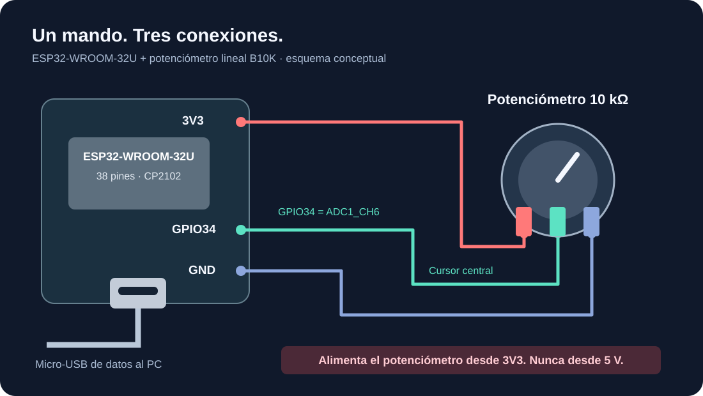

# Mando ESP32-WROOM-32U con potenciómetro

Esta revisión usa la placa ESP32-WROOM-32U de 38 pines con CP2102 y micro-USB indicada por el usuario. El firmware corresponde al **ESP32 clásico**. La posición del potenciómetro viaja por cable al juego de Windows; la nave dispara automáticamente y los menús se manejan en el PC.

El cambio de placa requiere mover el cursor del potenciómetro a **GPIO34** y cargar el nuevo sketch `firmware/Esp32Wroom32UPotController/Esp32Wroom32UPotController.ino`. No uses el sketch anterior para ESP32-S3. El protocolo que recibe C# conserva el mismo formato.

## Componentes y cableado

- Placa ESP32-WROOM-32U de 38 pines con CP2102.
- Potenciómetro **lineal de 10 kΩ**, normalmente marcado B10K.
- Tres cables y un cable **micro-USB de datos** para el PC.
- Opcional: condensador cerámico de **100 nF** entre GPIO34 y GND, cerca de la placa, para filtrar ruido. [Recomendaciones de ADC de Espressif](https://docs.espressif.com/projects/esp-hardware-design-guidelines/en/latest/esp32/schematic-checklist.html#adc).

Desconecta el USB antes de cablear:

| Terminal del potenciómetro | Pin de la placa |
|---|---|
| Un extremo | **3V3** |
| Central o cursor | **GPIO34**, marcado **34** o **IO34** |
| El otro extremo | **GND** |

**No conectes el potenciómetro ni GPIO34 a 5 V, VIN o VBUS.** Alimenta la placa con su micro-USB y toma la alimentación del potenciómetro desde su pin regulado 3V3. No necesitas una fuente externa adicional.



GPIO34 es **ADC1_CH6**, una entrada analógica del ESP32 clásico. Es de solo entrada y no dispone de resistencias internas pull-up/pull-down; este circuito lo alimenta mediante el cursor del potenciómetro. **34 es el número GPIO, no el puesto 34 de la cabecera**. El esquema es conceptual: sigue las etiquetas impresas en la placa. [GPIO oficiales de Espressif](https://docs.espressif.com/projects/esp-idf/en/stable/esp32/api-reference/peripherals/gpio.html), [cabeceras del DevKitC V4](https://docs.espressif.com/projects/esp-dev-kits/en/latest/esp32/esp32-devkitc/user_guide.html#header-block).

El módulo **32U** tiene un conector para antena externa. Este firmware no inicia Wi-Fi ni Bluetooth y envía todo por USB/UART; por eso no necesita la antena para controlar el juego. Si más adelante agregas radio, utiliza la antena adecuada al módulo. [Ficha del ESP32-WROOM-32U](https://www.espressif.com/sites/default/files/documentation/esp32-wroom-32d_esp32-wroom-32u_datasheet_en.pdf).

## Cargar desde Arduino IDE

1. Abre Arduino IDE. En **Archivo → Preferencias → URLs adicionales del gestor de placas**, agrega este índice estable:

   ```text
   https://espressif.github.io/arduino-esp32/package_esp32_index.json
   ```

2. En el **Gestor de placas**, busca e instala **esp32 by Espressif Systems**. No necesitas librerías adicionales. [Instalación oficial de Arduino-ESP32](https://docs.espressif.com/projects/arduino-esp32/en/latest/installing.html).
3. Extrae el ZIP del proyecto. Abre **`firmware/Esp32Wroom32UPotController/Esp32Wroom32UPotController.ino`**. Conserva la carpeta y el archivo con el mismo nombre.
4. En **Herramientas → Placa → esp32**, selecciona **ESP32 Dev Module**. Ajusta los siguientes valores si aparecen:

   | Opción | Valor para esta placa |
   |---|---|
   | Board / Placa | **ESP32 Dev Module** |
   | Flash Size | **4MB (32Mb)** |
   | PSRAM | **Disabled** |
   | Partition Scheme | **Default 4MB with spiffs** |
   | Upload Speed | **115200** |
   | Core Debug Level | **None** |
   | Otras opciones | Valores predeterminados de ESP32 Dev Module |

   Los nombres pueden variar ligeramente por versión. El módulo WROOM-32U tiene 4 MB de flash. El menú **USB CDC On Boot** de la guía anterior para S3 no se utiliza en esta placa: el micro-USB se comunica mediante el puente CP2102 conectado a UART0. [Menú de herramientas de Espressif](https://docs.espressif.com/projects/arduino-esp32/en/latest/guides/tools_menu.html).

5. Conecta el cable micro-USB al PC. En **Herramientas → Puerto**, selecciona el **COM** que aparece al conectar la placa. Si no aparece, prueba un cable de datos y consulta en el Administrador de dispositivos de Windows. Si falta el controlador, instala **CP210x Universal Windows Driver** desde [Silicon Labs](https://www.silabs.com/software-and-tools/usb-to-uart-bridge-vcp-drivers).
6. Cierra el juego o desconecta su mando, así como cualquier Monitor Serie abierto. Pulsa **Verificar** y después **Subir**. La carga reemplaza el programa que tenga actualmente el ESP32.
7. Si la carga queda en `Connecting...`, mantén pulsado **BOOT**, pulsa y suelta **EN**, y conserva BOOT pulsado mientras inicia la conexión. Suelta BOOT cuando aparezca la escritura del firmware. Si da error antes de conectar, repite **Subir** manteniendo BOOT durante la conexión. Al terminar, suelta BOOT y pulsa **EN** si el programa no arranca. [Modo de programación oficial](https://docs.espressif.com/projects/esptool/en/latest/esp32/advanced-topics/boot-mode-selection.html).
8. Abre el **Monitor Serie a 115200 baudios**. Gira el potenciómetro: deben aparecer líneas como estas, con un número que varía:

   ```text
   POT:120
   POT:2048
   POT:3970
   ```

9. **Cierra el Monitor Serie y el Plotter Serie**. Abre el juego, elige el modo ESP32, selecciona ese COM y pulsa **Conectar**. Espera a ver una lectura ADC válida e inicia una misión.

BOOT y EN sirven para programar o reiniciar la placa; no son botones de control del juego.

## Calibrar el recorrido

En el juego, gira a cada extremo, espera medio segundo y observa el valor ADC. Usa esos valores para ajustar **mínimo** y **máximo**; debe cumplirse mínimo < máximo. Si el movimiento va al revés, marca **Invertir**. También puedes intercambiar los dos terminales exteriores con el USB desconectado.

El firmware solicita 12 bits, promedia ocho lecturas y aplica un filtro exponencial. Usa `ADC_11db`; en el ESP32 clásico la documentación indica un rango medible aproximado de **150 a 3100 mV**. Con el potenciómetro entre GND y 3V3 puede haber zonas sin cambio cerca de los extremos. La calibración adapta el movimiento al recorrido útil, pero no recupera información de una zona saturada ni convierte el ADC en un voltímetro preciso. [API ADC de Arduino-ESP32](https://docs.espressif.com/projects/arduino-esp32/en/latest/api/adc.html).

Si desconectas el ESP32 durante una misión, el juego pausa al perder las lecturas válidas. Reconecta el mando y reanuda cuando haya datos.

## Cómo viaja el dato hasta C#

```text
Giro → tensión del cursor → GPIO34 / ADC1_CH6 → analogRead()
     → promedio y filtro → "POT:2048\n" → UART0 → CP2102
     → micro-USB → puerto COM → PotentiometerController → posición de la nave
```

El PC ejecuta animaciones, música, disparos, niveles y guardado en SQL Server. El ESP32 solo mide y transmite posición.

| Ajuste | Valor |
|---|---|
| Velocidad serie | 115200 baudios |
| Formato | 8 bits, sin paridad, un bit de parada, sin control de flujo |
| Mensaje | ASCII `POT:<entero de 0 a 4095>` terminado en LF (`0x0A`) |
| Frecuencia objetivo | 50 mensajes/s, un muestreo cada 20 ms |

El receptor C# reconstruye líneas, admite también CRLF y descarta mensajes de arranque ajenos a `POT:`. Una línea inválida no renueva el tiempo de la última lectura válida. Si se llena el buffer UART, el firmware omite esa muestra; no existe confirmación de recepción del PC.

En `PotentiometerController.Connect()`, C# abre `SerialPort` con **DtrEnable = false**, **RtsEnable = false** y **Handshake.None**. Esto evita solicitar reinicio/programación durante el juego: en placas con CP2102 y circuito de reinicio automático, DTR/RTS intervienen en GPIO0 y EN. Arduino sí usa esas señales durante la carga. [DTR/RTS y arranque del ESP32](https://docs.espressif.com/projects/esptool/en/latest/esp32/advanced-topics/boot-mode-selection.html#automatic-bootloader).

## Diagnóstico

| Síntoma | Qué revisar |
|---|---|
| No aparece puerto COM | Cable micro-USB de datos y controlador CP210x de Silicon Labs. |
| Error indicando ESP32-S3, S2 o C3 | Selecciona **ESP32 Dev Module** y abre el nuevo sketch WROOM-32U. |
| `Failed to connect` o `Connecting...` | Puerto correcto; cerrar juego/monitor; secuencia BOOT/EN indicada arriba. |
| Puerto ocupado o acceso denegado | Cierra el Monitor Serie, Plotter Serie u otra instancia del juego. |
| COM abre pero no llega `POT:` | Carga el nuevo sketch, revisa 115200 y pulsa EN con BOOT suelto. |
| Valor siempre 0 o 4095 | Cursor en GPIO34, extremos en 3V3/GND y contactos firmes. |
| Nave vibra | Acorta cables, revisa contactos y añade 100 nF entre cursor y GND. |
| Movimiento invertido o no llega a los bordes | Ajusta Invertir y calibración de mínimo/máximo. |

El pin y las API se revisaron contra documentación oficial. No había una herramienta de compilación Arduino disponible en el entorno de entrega: **este sketch no se ha compilado ni cargado en una placa física**. Pulsa Verificar con la selección ESP32 Dev Module antes de subirlo y comprueba en tu montaje la lectura en el Monitor Serie, los extremos de calibración y el movimiento de la nave. Fuentes consultadas el 6 de octubre de 2026.

